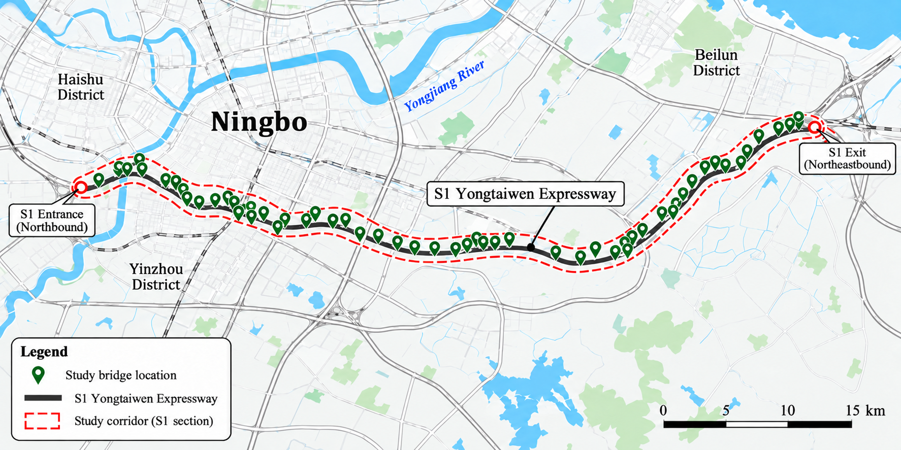

## 2 数据与方法

### 2.1 研究对象与监测数据

本文以甬台温高速公路宁波段一期桥梁为研究对象，选取沿线59个桥梁检测单元开展分析。研究对象包括主线桥和互通匝道桥；部分桥梁的左幅与右幅在检测台账中分别记录，因此59个检测单元并不等同于59座独立桥梁。研究路段及桥梁检测单元的空间分布如图1所示。

{width=15.6cm}

图1 甬台温高速公路宁波段一期研究路段及桥梁检测单元空间分布

Fig. 1. Location of the study expressway section and spatial distribution of bridge inspection units.

研究数据来自2012—2024年桥梁检测台账，主要包括全桥评分、上部结构评分、建成年份、桥梁长度、桥面净宽和功能类型。本文以原始台账中的检测单元为基本分析对象，利用历史检测记录预测后续全桥评分，并据此开展2025—2039年的养护时机规划。

59个检测单元在13年内共有767个潜在的“单元—年”观测位置，其中全桥评分有效记录387条，上部结构评分有效记录380条。缺失记录不视为0分，也不通过插值构造人工检测值。检测数据及缺失情况见表1。

表1 检测数据与缺失情况

| 项目 | 数量或范围 | 说明 |
|:---|:---|:---|
| 检测单元 | 59 | 保留原始检测单元划分 |
| 年份与潜在单元—年 | 2012—2024；767 | 13年×59个单元 |
| 全桥评分有效/缺失 | 387 / 380 | 缺失比例49.54% |
| 上部结构评分有效/缺失 | 380 / 387 | 缺失比例50.46% |
| 两类评分同时有效 | 380 | 另有7条仅全桥评分有效 |
| 2024年评分构成 | 6实测+53估计 | 两套规划初始状态保留相同实测值 |
| 主要时间外测试 | 216条；2018—2024年 | 下一次真实检测记录 |

以每个检测单元相邻两次真实全桥评分记录构建预测样本，共得到328条状态转移记录。其中，检测间隔为1、2、3、4年的样本分别为123、144、55、6条，表明样本的预测跨度并不一致。2024年仅有6个检测单元具有同期实测全桥评分，其余53个单元需要根据历史信息估计规划初始状态。桥梁长度、净宽和功能类型作为静态属性使用，并假设这些信息在历史预测时点已经可得。

### 2.2 全桥评分预测与时间外验证

为比较不同方法在低频检测条件下的预测表现，采用末次观测延续法（last observation carried forward，LOCF）、岭回归（Ridge regression，以下简称Ridge）和极端梯度提升（eXtreme Gradient Boosting，XGBoost）预测后续全桥评分。LOCF将预测起点最近一次真实全桥评分作为预测值；Ridge通过二范数正则化建立线性回归模型；XGBoost采用梯度提升树进行预测[17][18]。

Ridge与XGBoost使用相同的10个输入特征：目标年份桥龄、预测间隔、最近一次全桥评分、最近一次上部结构评分、上部结构历史缺失标记、桥梁长度、桥面净宽，以及三个功能类型指示变量。所有评分特征均从预测起点及以前的真实检测记录中提取，不使用目标年份的实际评分。上部结构历史信息不足时的处理方法及完整模型参数见补充材料S-M1。

为避免后续年份的信息进入模型训练，采用2018—2024年扩展时间窗口进行验证。当测试年份为$y$时，仅使用目标观测年份早于$y$的样本训练模型，并在该年实际取得的检测记录上检验预测结果，共获得216条时间外测试记录。与随机划分训练集和测试集相比，该方法更符合利用已有检测信息预测后续状态的实际应用顺序[12]。

缺失值处理和特征标准化参数均由当期训练集估计，不使用外层测试数据调整模型超参数。Ridge的正则化参数固定为10，XGBoost采用固定的浅层树设置，具体参数见补充材料S-M1。预测评分限制在$[0,100]$范围内。

采用均方根误差（root mean square error，RMSE）、平均绝对误差（mean absolute error，MAE）、决定系数$R^2$和Pearson相关系数$r$评价预测结果。所有模型均在相同的测试记录上计算评价指标，主要依据预测误差比较其表现。回顾性验证采用实际发生的后续检测间隔；规划应用则需事先确定预测目标年份及相应预测跨度。

### 2.3 规划初始状态构建

在评分预测与时间外验证的基础上，构建LOCF和Ridge两套2024年候选规划初始状态，用于比较不同状态估计方法对后续养护安排的影响。两套方案均保留6个检测单元在2024年的真实检测评分；对于其余53个缺少同期实测评分的单元，LOCF方案沿用最近一次真实全桥评分，Ridge方案则根据历史检测信息预测2024年全桥评分。

Ridge初值模型采用目标观测年份早于2024年的322条状态转移记录进行训练，沿用第2.2节的特征提取与预处理方法，不引入待估单元在2024年的同期评分。逐单元记录规划初值的来源及最近一次真实检测年份，并在后续各资源情景中保持初始状态不变。

两套规划初始状态均保留相同的6个实测评分，其余53个评分分别由LOCF和Ridge估计。缺测单元缺乏2024年的同期真实评分，因此两套方案仅表示不同方法构建的候选规划起点，不能将其中一套作为另一套的实测参照。

### 2.4 养护规划模型

基于上述候选规划初始状态，建立养护时机规划模型。考虑到现有检测资料覆盖2012—2024年，且年评分下降量和养护后评分恢复量尚未由真实养护事件校准，将规划期设为2025—2039年，以减少较长时间外推假设对规划结果的累积影响。单元编号记为$i$，规划年份记为$t$；$S(i,t)$表示年末评分，$S_{\mathrm{pre}}(i,t)$表示当年评分下降后、养护前的评分，$x(i,t)\in\{0,1\}$表示是否实施养护。起始评分$S(i,2024)$取对应的候选规划初值。

模型不区分具体养护工艺，将预防性养护抽象为一类统一的状态改善行动。养护后评分恢复量$R=6$，单位为分，仅作为情景参数用于比较不同规划条件下的养护时机，不对应某一种具体工程措施的实测效果。年评分下降量记为$d$，参考情景取$d=0.65$分/年。年度递推依次进行评分下降、实施养护和年末评分计算：

$$
S_{\mathrm{pre}}(i,t)=\max\left\{0,\ S(i,t-1)-d\right\},
$$

$$
S(i,t)=\min\left\{100,\ S_{\mathrm{pre}}(i,t)+R\,x(i,t)\right\}.
$$

每年最多养护8个单元，同一单元相邻行动至少间隔3年，15年内最多养护3次。依据JTG/T 5230—2026评分区间，将年末评分映射为1—5类[19]。规划要求所有单元每年年末评分$>60$，且至少57/59个单元评分$>75$；其中，57/59为本文设置的管理目标。评分区间映射不代替完整技术状况评定。主要情景与约束见表2，评分区间及数值容差见补充材料S-M2。

表2 规划参数及其性质

| 参数或条件 | 设置 | 性质 |
|:---|:---|:---|
| 规划范围与目标 | 2025—2039年，15年；59单元等权$J$ | 长期情景规划 |
| 年评分下降量$d$ | 0.65分/年；敏感性0.45、0.85 | 情景参数，未由养护事件识别 |
| 养护后评分恢复量$R$ | 6分，评分上限100 | 情景参数，未用前后记录校准 |
| 归一化养护资源 | $r_i=A_i/A_{\mathrm{total}}$；$B_{\mathrm{used}}=\sum_t\sum_i x(i,t)r_i$ | 面积占比；无量纲 |
| 年末评分管理条件 | 全部$>60$；至少57/59个$>75$ | 本文管理目标 |
| 年度养护数量上限 | 8个单元 | 规划能力约束 |
| 同单元间隔/累计次数 | 至少3年；最多3次 | 规划行动约束 |
| 求解设置 | 种群30；10000次候选评价；每主要情景30次运行 | 固定计算设置 |
| 公共候选检查 | 当前情景重新核验的规则与已知可行候选 | 当前条件复算后选一个初始成员 |

注：评分区间映射依据JTG/T 5230—2026；至少57/59个单元评分$>75$的比例由本文设置。

以单元长度与净宽的乘积表示面积$A_i$，全部单元总面积为$A_{\mathrm{total}}$，单次行动的面积占比资源为$r_i$。累计归一化资源使用量记为$B_{\mathrm{used}}$，给定的累计资源上限记为$B$：

$$
r_i=\frac{A_i}{A_{\mathrm{total}}},\qquad
A_{\mathrm{total}}=\sum_i A_i,
$$

$$
B_{\mathrm{used}}=\sum_t\sum_i x(i,t)r_i\leq B.
$$

该资源指标与评分无关，同一单元重复养护时重复计量。$B$是无量纲相对资源上限；$B=1$表示允许的累计处理面积等于全部检测单元总面积的一倍，不要求各单元恰好处理一次。该面积尺度不能直接换算为实际养护支出。

长期平均评分记为$J$，取59个单元、15个规划年份共885个年末评分的算术平均，各单元权重相同：

$$
J=\frac{1}{59\times15}\sum_{t=2025}^{2039}\sum_{i=1}^{59} S(i,t).
$$

### 2.5 金豺优化算法与养护排程求解

在上述模型与约束下，采用标准金豺优化算法（Golden Jackal Optimization, GJO）搜索养护排程[20]，并以可行性优先原则处理约束[21]。种群规模为30，每次运行进行10000次候选评价。初始化时，对规则候选与已知可行候选按当前情景重新核验，并选择一个作为初始成员。行动年份编码、超出年度能力时的接纳规则及完整求解设置见补充材料S-M3。

为确定共同资源范围，在相同初值、参数及约束条件下，分别搜索LOCF的最低可行资源方案与无累计资源上限的高状态方案，得到最好已知最低可行资源$B_{\min}=0.013815$和高状态参考资源$B_{\mathrm{ref}}=2.295642$。两者均为有限搜索的参考值。Ridge另作最低资源需求诊断，不用于建立第二条资源轴。

### 2.6 优化试验设计与评价指标

两套候选规划初始状态使用同一组绝对资源上限。设计变量$\rho$取$0,\ 1/6,\ \ldots,\ 1$，按$B=B_{\min}+\rho(B_{\mathrm{ref}}-B_{\min})$等距设置7档资源上限，即0.013815、0.394120、0.774424、1.154729、1.535033、1.915337和2.295642；计算采用完整精度，正文保留6位小数，预先选定中档$B=1.154729$作为代表资源水平。端点选择及完整精度见补充材料S-M2。每个主要情景以30个随机种子分别运行，每档按相同随机种子组成30对LOCF与Ridge排程。年评分下降量敏感性分析固定LOCF初值和该绝对资源上限，仅将$d$设为0.45、0.65、0.85分/年，其余设定不变。将相同规划初始状态、相同$d$下零行动递推的长期平均评分记为$J_0$，以$\Delta J=J-J_0$表示养护增益，零行动基线不要求满足管理条件。仅对可行结果报告均值、样本标准差（SD）与最好值，并汇总2039年平均评分、规划期最低评分、行动数和资源使用率$B_{\mathrm{used}}/B$。以“单元—年份”为行动集合元素，采用交集与并集的行动数之比计算Jaccard相似系数；首次养护年份平均绝对差仅在每对排程双方均养护的单元中计算，再汇总配对层面的分布。未养护年份及无共同养护单元的配对统计记为缺失，并报告实际样本数；配对差统一取Ridge减LOCF。代表方案取预定资源档30次可行运行中$J$最高者，并列选择规则见补充材料S-M3。全部保存排程均经独立逐年复算，核对状态、资源和管理条件。
